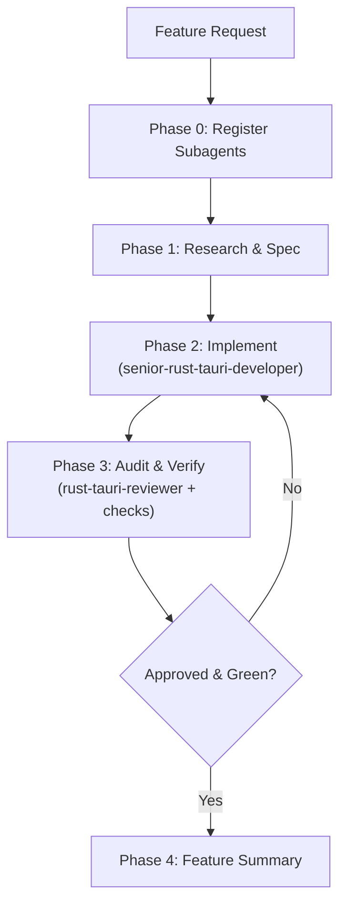

# Rust + Tauri 2 Feature Development Workflow

Use this skill to take a feature from architectural design to verified implementation in OpenIDEA by orchestrating specialized subagents.

---

## Phase 0: Ensure Subagents Are Defined

Subagents defined with `define_subagent` persist for the current conversation. Before invoking them, ensure both subagents from `references/` are registered (skip any already defined in this session):

1. Read [senior-rust-tauri-developer.md](references/senior-rust-tauri-developer.md) and call `define_subagent`:
   - `name`: `senior-rust-tauri-developer`
   - `enable_write_tools`: `true`
   - `enable_mcp_tools`: `true`
   - `enable_subagent_tools`: `false`
   - `system_prompt`: exact prompt from the reference file
2. Read [rust-tauri-reviewer.md](references/rust-tauri-reviewer.md) and call `define_subagent`:
   - `name`: `rust-tauri-reviewer`
   - `enable_write_tools`: `false`
   - `enable_mcp_tools`: `false`
   - `enable_subagent_tools`: `false`
   - `system_prompt`: exact prompt from the reference file

---

## Phase 1: Research & Architecture Spec

Explore the codebase (directly or via the built-in `research` subagent) to locate existing patterns and produce a concrete spec before any edits:

1. **Backend placement**:
   - Identify which `crates/ide-*` domain crate owns the logic (or whether `ide-core` needs shared types).
   - Decide command placement:
     - Project-scoped / remote-capable → `crates/ide-host/src/ops/<domain>.rs` with `#[command(trust = ...)]` + `ide_command::domain!` + `ide_command::domains!`.
     - Desktop-only / shell UI → `src-tauri/src/commands/<domain>.rs` with `#[desktop_command(trust = ...)]` + `ide_command::desktop_domain!` + `catalogue()`.
   - Specify `TrustClass` (`always` | `outside_restricted` | `trusted`), streaming (`Channel<T>`), cancellation (`RequestId` + `CancellationToken`), and events (`IdeEvent` via `EventSink`).
2. **Frontend placement**:
   - Identify `src/features/<name>/` (or existing feature), registration in `src/features/index.ts`, contributions in `src/workbench/contributions.ts`, actions/keymaps (`src/platform/keymaps/`), `src/ui/` primitives, and locale keys (`en.json` + `zh.json`).
3. **Acceptance criteria & test plan**:
   - Define concrete Rust unit/integration tests, frontend Vitest tests, and runtime `/verify` scenario (if UI/runtime behavior changes).

If critical product behavior is ambiguous, ask the user before implementing.

---

## Phase 2: Implementation (`senior-rust-tauri-developer`)

Invoke `senior-rust-tauri-developer` via `invoke_subagent` with:
- The Phase 1 spec (target crates/files, command signatures, trust classes, frontend hooks, acceptance criteria).
- Clear instruction to implement backend → run `pnpm gen:bindings` (if IPC changed) → implement frontend → add tests & `en.json`/`zh.json` entries → run scoped checks.

If the feature has independent backend and frontend tracks after bindings are generated, keep IPC contract changes serialized first (`backend + pnpm gen:bindings`), then implement or verify the frontend against `src/bindings.ts`.

---

## Phase 3: Audit & Verification

1. **Code Review**:
   - Invoke `rust-tauri-reviewer` via `invoke_subagent` with the list of changed files and the Phase 1 spec.
   - If the verdict is `CHANGES_REQUESTED`, send the blocking items back to the existing `senior-rust-tauri-developer` subagent via `send_message` and re-audit until `APPROVED`.
2. **Verification Gates** (run individually so slow steps don't time out):
   - IPC bindings (if Rust commands/types changed): `pnpm gen:bindings` and verify `git diff -- src/bindings.ts` is intentional.
   - Rust: `cargo fmt --all --check`, `cargo nextest run -p <crates>`, `cargo clippy -p <crates> --all-targets -- -D warnings`.
   - Frontend: `pnpm typecheck`, `pnpm lint`, `pnpm format:check`, `pnpm vitest run <test-paths>`.
   - Runtime / UI: run `/verify` (`pnpm tauri dev` / `pnpm dev:app` + `pnpm dev:status` + Tauri MCP) when the feature changes user-visible UI or runtime behavior, capturing `before.png` / `after.png` in your scratch directory.

---

## Phase 4: Final Summary

Report concisely to the user:
- **Implemented**: summary of backend + frontend architecture and key symbols.
- **Files Changed**: grouped by backend crates, `src-tauri`, `src/bindings.ts`, and `src/`.
- **Verification**: exact commands run, pass/fail results, reviewer verdict, and `/verify` evidence paths (if UI changed).
